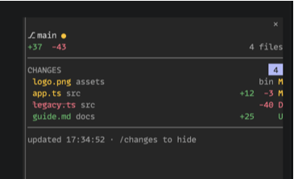

# git-changes

A live Source Control pane for Claude Code: see which files changed, and by how much, without running `git status`.



## What it does

- Lists every changed file in the current repo, with a status letter: `M` modified, `A` added, `D` deleted, `R` renamed, `U` untracked, `!` conflict.
- Shows lines added (`+N`, green) and removed (`-N`, red) per file and in total. Binary files show `bin`.
- Colours file names by status, and strikes through deleted files.
- Shows the branch, a `●` when the tree is dirty, and `↑ ↓` when you have unpushed or unpulled commits.
- Refreshes right after Claude edits files, and every 2 seconds while the pane is visible.

## Install

Give your coding agent this prompt:

```
Read https://github.com/fbandres/ccmods/blob/main/SETUP.md
and install the git-changes mod for me.
```

Or install it yourself:

```
/plugin marketplace add fbandres/ccmods
/plugin install git-changes@ccmods
/reload-plugins
```

## Usage

- `/changes` shows or hides the pane. The choice is remembered on this machine for future sessions.
- If a future Claude Code built-in ever takes `/changes`, the mod registers `/git-changes` instead, which does the same.

## How it works

- **Refresh:** after `Edit`, `Write` and `Bash` tool calls, every 2 s while the pane is placed, and when it opens.
- **Git:** three calls run in parallel, all with `--no-optional-locks` so they never block your own `git commit`:
  `git status --porcelain=v2 -b -z -uall`, `git diff --numstat -z` and `git diff --cached --numstat -z`.
- **New files:** git has no diff for them, so their lines are counted from disk (up to 50 files, 256 KB each). A file containing a NUL byte counts as binary.
- **One row per file:** when a file has both staged and unstaged changes, the most significant letter wins, `! > D > A > R > M > U`.
- **Cheap redraws:** nothing redraws while git's output and the new-file counts are unchanged.

| Letter | Meaning | Colour |
|---|---|---|
| `!` | Conflict | magenta |
| `D` | Deleted | red |
| `A` | Added | green |
| `R` | Renamed | green |
| `M` | Modified | yellow |
| `U` | Untracked | green |

## Limits

- The pane opens by itself only in terminals about 144 columns or wider. Otherwise run `/changes`.
- It's read-only: no staging, committing or diffs.
- Wide characters (CJK, emoji) in file names can push a row past its column.

## License

MIT. See [LICENSE](../../LICENSE).
