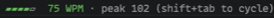

# wpm-gauge

A live words-per-minute gauge under Claude Code's prompt box.



## What it does

- Shows a 5-bar gauge as you type a prompt: the first bar lights as soon as there's a reading, then one more per 20 WPM, coloured red → orange → yellow → green → cyan.
- Shows your current WPM, plus the peak for the current typing streak.
- Adds ⚡ when all 5 bars are lit (80+ WPM).
- Drains back to zero after you stop typing, and clears the peak once it's empty.

## Install

Give your coding agent this prompt:

```
Read https://github.com/fbandres/ccmods/blob/main/SETUP.md
and install the wpm-gauge mod for me.
```

Or install it yourself:

```
/plugin marketplace add fbandres/ccmods
/plugin install wpm-gauge@ccmods
/reload-plugins
```

## Usage

Nothing to run: the gauge is always on while the mod is installed. Disable it with `claude plugin disable wpm-gauge@ccmods`.

## How it works

- **Standard WPM:** 5 characters count as one word, measured over a rolling 10-second window.
- **Noise guards:** no reading under 3 characters, and short bursts are measured over at least 2 seconds so they can't read as thousands of WPM. Inserts longer than 8 characters count as pastes and are ignored, as are Ctrl and Alt/Meta shortcuts.
- **Draining:** the reading is recomputed once a second, so the gauge falls back once you stop.
- **Pure maths:** the calculation is in `hooks/wpm.ts`, separate from the hooks, so it's easy to test and tweak.

## Limits

- It counts typing in the prompt box only.

## License

MIT. See [LICENSE](../../LICENSE).
